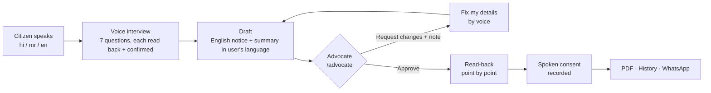

# Arzi — अर्ज़ी

**Speak your legal problem, get a lawyer-verified document.**

A tenant whose landlord or PG owner has not returned the security deposit speaks their problem in **Hindi, Marathi or English** (or a mix, like Hinglish). Arzi asks the follow-up questions by voice, drafts a formal English legal notice, and sends it to an advocate to check. Once the advocate approves, Arzi reads the notice back point by point in the person's own language and records their spoken consent. The person never has to type.

> Prototype for Scaler x Wispr Flow "India Runs on Voice", Round 2. Theme: public infrastructure and civic services. **Prototype, not legal advice.**

**Live demo:** https://arzi-2p1d.onrender.com (open it in Chrome). The advocate desk is at [`/advocate`](https://arzi-2p1d.onrender.com/advocate), PIN **`1234`**. It runs on Render's free tier, so if nobody has used it for a while the first visit can take about a minute to load.

## Run it (no keys needed)

```bash
git clone https://github.com/Sahaj1207/arzi.git
cd arzi
docker compose up
```

Open **http://localhost:3000** in **Google Chrome** or **Microsoft Edge**. You don't need a `.env` file or any API keys.

- Advocate desk: **http://localhost:3000/advocate**, demo PIN **`1234`** (change it with `ADVOCATE_PIN`).
- Sample cases are added on every start, so the advocate desk always has something to review.
- Data (the SQLite database, consent recordings and PDFs) is kept in the `arzi-data` Docker volume.

## 2-minute tour for judges

No microphone? Both of these work without one:

1. On the home page, press **Try a sample case**. The real voice interview runs, with the sample answers appearing on screen word by word as if someone were speaking them. Arzi asks each question, repeats each answer back and confirms it. The demo advocate then approves the notice, and the read-back and consent screen opens.
2. Or press **Skip to an approved document** to go straight to that screen.

On the read-back screen, try:

- **Pause / Continue**, **Repeat this point** and **Slower / Faster** (the speed is remembered on the device).
- Saying "English" to hear the full English notice instead of the summary.
- Giving consent, either by saying "yes, I understood and I agree" or with the button.
- **Download PDF**, **Share on WhatsApp** and **History** (each consent recording can be played back there).

With a microphone, press the big mic and say something like *"Mere landlord ne mera deposit wapas nahi kiya"* or *"My PG owner has not returned my deposit"*.

Then open **/advocate** (PIN `1234`). You can edit the notice and **Approve** it, or **Request changes** with a note. If you request changes, the citizen sees your note and a **Fix my details** button, corrects the details by voice, and the fixed notice comes back to you as version 2.

## How it works



**The notice:** it is sent by the tenant in their own name. It gives the landlord **15 days** to pay, claims **the deposit only**, and reserves the right to claim interest and legal costs. The line "Reviewed by Advocate [name]" appears only after the advocate approves.

**Questions asked:** your name, your address (the rented place), the landlord's name, the landlord's address ("same as mine" works), the deposit amount, the date you moved out, and how long the deposit has been pending.

## When things go wrong

| Situation | What Arzi does |
|---|---|
| Noise or unclear speech | "I could not hear you clearly…", then asks again. After 2 failed tries, a keyboard appears. |
| Misheard numbers or names | Every answer is read back and confirmed. Amounts and dates are shown large and read digit by digit. "Change the amount" fixes a single field. |
| Amounts spoken as words | "bees hazaar", "saadhe atharah hazaar", "twenty thousand", "वीस हजार" and digits are all understood. If an amount can't be read, Arzi asks again instead of guessing. |
| Mixed languages | Hinglish and Marathi-English are accepted. Saying "Speak in Marathi" switches the language. |
| Silence | After 8 seconds Arzi repeats the question once, then pauses with a **Tap to continue** button. |
| A problem that isn't about a deposit | Arzi explains that this prototype only drafts deposit notices and offers to note the problem for an advocate. |
| Violence or an emergency | Arzi shows **112** right away and stops drafting. |
| Browser without speech recognition | Arzi says so clearly and shows the keyboard. |
| PDF engine fails | The app keeps running and opens a printable page instead (Print → Save as PDF). |
| A paid AI service fails or runs out of credits | The session switches to browser speech by itself and asks the question again. |

## Demo mode vs AI mode

Everything works in **Demo mode** with no keys. Adding a [Sarvam AI](https://docs.sarvam.ai) key in `.env` (`SARVAM_API_KEY`) turns on **AI mode**:

| | Demo mode (default) | AI mode (Sarvam key set **and** the citizen agrees) |
|---|---|---|
| Speech to text | Browser Web Speech API | Sarvam `saaras:v4`: the answer is recorded and uploaded; better with code-mixed speech and noise |
| Voice | Browser speech synthesis | Sarvam `bulbul:v3`, used only when the browser has no voice for the language (often the case for Telugu) |
| Understanding answers | Built-in parsers and keywords | The same, plus `sarvam-105b-conversations` for answers the parsers can't read. The AI only *suggests* a value; Arzi still reads it back and the citizen confirms it. |
| Notice | Legal template | The same template. Names and addresses spoken in Devanagari or Telugu script are transliterated into English letters for the English notice; the summary keeps the original script. |

- **Consent first:** with a key set, Arzi asks once per session, before anything is sent, whether it may send the citizen's voice and words to Sarvam AI. Saying no keeps the whole session on browser speech.
- **Never stuck:** any Sarvam error, timeout or "out of credits" switches the session back to browser speech. The footer line shows which is in use.
- **Keys stay on the server.** The browser only learns *which* services are on, never the key. Paid calls are capped per anonymous user and per IP per day (`PAID_CALLS_PER_USER_PER_DAY`, `PAID_CALLS_PER_IP_PER_DAY`), so a public link can't use up all the credits.
- Wispr Flow (access is by approval only) and Anthropic are planned but not built yet. Their keys are ignored.

All settings are optional and listed in [`.env.example`](.env.example).

## Languages

| Language | Status |
|---|---|
| Hindi, Marathi, English | Fully supported without keys: questions, number and date words, yes/no, summaries, PDF fonts |
| Telugu | Built, but waiting for review by our Telugu-speaking teammate. It is hidden from the picker until a device opens [`/?telugu=1`](https://arzi-2p1d.onrender.com/?telugu=1). The review sheet is [`docs/telugu-review.md`](docs/telugu-review.md). |
| Other Indian languages ("Beta") | Planned; they need a Sarvam key |

## Browser notes

- Voice input needs **Chrome or Edge** (desktop or Android). Other browsers show a message and the keyboard.
- Chrome's speech recognition sends audio to Google, so it **needs an internet connection**.
- The microphone works only on **https://** or **localhost**. A phone that opens the app through your laptop's LAN IP won't get mic access, so use the HTTPS live link instead.
- PDFs are made with headless Chromium inside the Docker image, using bundled Noto fonts so Hindi, Marathi and Telugu letters join correctly. Only one PDF is made at a time, and Chromium is closed after 60 s idle.

## Live demo on Render (free tier)

[`render.yaml`](render.yaml) deploys the same Docker image with HTTPS, which phones need for the microphone.

| Free-tier limit | What Arzi does |
|---|---|
| No disk: data is wiped on every restart or redeploy | Sample cases are re-created on every start |
| 0.1 CPU: a Chromium PDF takes about 55 s | `PDF_ENGINE=print`: **Download PDF** opens the print page (Save as PDF) |
| Sleeps after 15 minutes idle | Pinged on `/api/health` by an uptime monitor |

## Development (without Docker)

You need Node.js 22 or newer.

```bash
npm install
npm run build        # build the React app into client/dist
npm start            # API + app on http://localhost:3000
npm test             # 102 tests: parsers, interview, API, advocate, PDF, Sarvam (fake server)
```

For live reload, run `npm run dev:server` and `npm run dev:client` in two terminals, then open http://localhost:5173.

The tests never read your `.env` and never call the real Sarvam API. The Sarvam tests run against a fake local server.

## Project layout

```
shared/   used by client + server: languages, all text (i18n), the 7 fields,
          parsers for amounts / dates / yes-no / intent in hi, mr, en, te
server/   Express 5 API, SQLite (better-sqlite3), drafting templates,
          Sarvam provider, usage caps, PDF (Puppeteer + Chromium), demo seed
client/   React 19 + Vite: voice layer (speech provider, ask loop, TTS),
          the interview as an async script, read-back + consent, advocate desk
scripts/  telugu-review.mjs builds the Telugu review sheet
```

Some key files:

- `client/src/conversation/interview.js`: the whole voice interview, step by step.
- `client/src/voice/ask.js`: one question → listen → handle noise, silence and fallbacks.
- `shared/src/parse/`: spoken numbers and dates in four languages.
- `server/src/drafting/`: the legal notice and the plain-language summary.
- `server/src/routes/ai.js`: the consent gate, usage caps and fallback for every paid call.

## Credits

Fonts: Noto Sans Devanagari, Noto Sans Telugu, Noto Serif Devanagari and Mukta, all under the SIL Open Font License (see `server/assets/fonts/OFL-LICENSE.txt`).
